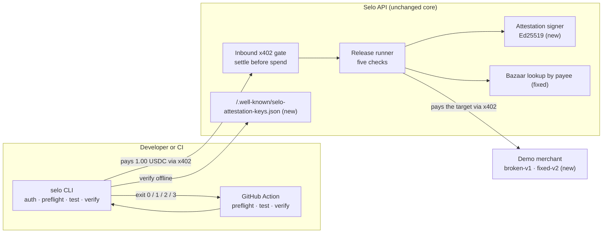

# Technical summary: Selo as a payment-aware release gate

Selo already paid an authorized x402 endpoint as a real client and returned a deterministic
verdict. This work turns that verdict into a gate a pipeline can enforce. It adds an owned
merchant that shows the failure mode, a CLI with a strict exit contract, a GitHub Actions gate,
signed attestations that verify offline, and a fix that brings the discovery check back against
today's Bazaar catalog. The settle-before-spend core, the spend ledger and the verdict reducer are
unchanged.

## What changed

| Area                | Files                                                                                                                     | What it does                                                                                                                                                                                                                                                                                                                                                                                                                                                                                                                                    |
| ------------------- | ------------------------------------------------------------------------------------------------------------------------- | ----------------------------------------------------------------------------------------------------------------------------------------------------------------------------------------------------------------------------------------------------------------------------------------------------------------------------------------------------------------------------------------------------------------------------------------------------------------------------------------------------------------------------------------------- |
| Demo merchant       | `examples/merchant/`                                                                                                      | A stock `@x402/hono` merchant with two releases at one URL. `broken-v1` settles and answers 200 with `receipt_id`; `fixed-v2` returns the declared `receiptId`. Both have the same 402, Bazaar metadata and health check. `contract.json` is kept equal to the advertised receipt schema by a test                                                                                                                                                                                                                                              |
| CLI                 | `packages/cli/`                                                                                                           | `selo auth create\|verify\|status`, `selo preflight`, `selo test`, `selo verify`. It reuses Selo's own payment client (`apps/api/src/tools/pay-flow.ts`) through a narrow export, so there is no second signing path                                                                                                                                                                                                                                                                                                                            |
| Client payment flow | `apps/api/src/tools/pay-flow.ts`, `pay-probe.ts`, `payment-decision.ts`                                                   | Carries the full release contract, an expected network, an approved budget and the release id. Every refusal says why: policy, rejected or unreachable                                                                                                                                                                                                                                                                                                                                                                                          |
| GitHub Actions      | `.github/actions/release-gate/action.yml`, `examples/github-actions/`                                                     | A composite action in three modes: `preflight` (free, no wallet), `test` (pays once) and `verify` (offline). The example workflow stages without secrets, runs the paid gate in a protected environment, and promotes only a verified signed PASS for the exact commit                                                                                                                                                                                                                                                                          |
| Attestation         | `apps/api/src/reports/attestation.ts`, `keys-route.ts`, `packages/core/src/canonical.ts`, `packages/core/src/contract.ts` | Ed25519 over the payload's canonical JSON, inside a `{ payload, signature }` envelope, with keys published at a well-known URL                                                                                                                                                                                                                                                                                                                                                                                                                  |
| Release id          | `apps/api/src/release/request.ts`, `jobs.ts`, migration `0001`                                                            | Optional `deploymentId` on the paid request, stored on the job and attested as `asserted_by_client`                                                                                                                                                                                                                                                                                                                                                                                                                                             |
| Discovery fix       | `apps/api/src/catalog/client.ts`                                                                                          | Looks a target up among its own payee's Bazaar listings. The full catalog (over 2,600 entries, capped at 100 per page) no longer fits a bounded read                                                                                                                                                                                                                                                                                                                                                                                            |
| Reconciliation      | `apps/api/src/reconcile/`, `apps/api/src/tools/reconcile.ts`, migration `0002`                                            | `pnpm --filter @selo/api reconcile` looks each held downstream payment up on the Algorand indexer. It settles a confirmed transfer that matches asset, receiver, amount and Selo's sender. It releases one only when Selo's own signed transaction is absent and the indexer is past its last-valid round, which is now recorded at signing. Anything else stays held with an alert. Each change is one conditional update plus the counter move, so parallel or repeated runs converge. It never signs, never pays and never changes a verdict |
| Wallet tooling      | `apps/api/src/tools/account-*.ts`                                                                                         | A `demo-merchant` role for opt-in and status                                                                                                                                                                                                                                                                                                                                                                                                                                                                                                    |

## Contracts

- **Paid request** `POST /v1/release-test`:
  `{ preflightId, profile: "quick", expected?: { status?, contentType?, jsonSchema? }, deploymentId? }`.
  `deploymentId` matches `^[A-Za-z0-9._-]{1,128}$`. Older clients are unaffected.
- **Response:** unchanged, plus an optional `attestation` when the server has a signing key.
- **Attestation payload** `selo.release.v1` contains:
  - the issuer and the job;
  - the tested URL and method;
  - `deployment: { id, verification: "asserted_by_client" } | null`;
  - `testedAt` and `completedAt`, and the Selo version;
  - the verdict, every check with its status, code, blocking flag and evidence ids;
  - a SHA-256 of the release contract and of the target's 402;
  - the inbound and downstream transactions with their amounts;
  - a manifest of the evidence rows with their hashes, and its digest.

  It carries no secret, request body or report token. Ed25519 and a payload built only from stored
  fields make a duplicate request return a byte-identical attestation.

- **CLI exit codes:**

  | Exit | Meaning                                                                   |
  | ---- | ------------------------------------------------------------------------- |
  | `0`  | A fully evidenced PASS, re-derived from the report's own checks           |
  | `1`  | A proven FAIL                                                             |
  | `2`  | INCONCLUSIVE, an unconfirmed payment, or a missing or inconsistent report |
  | `3`  | Refused before paying                                                     |

  `selo verify` exits with the attested verdict, or 2 when the attestation cannot be verified for
  the expected release, URL and method.

- **Summary** `selo.gate.v1`: a sanitized JSON for CI artifacts. The report link is redacted.

## Security model

| Invariant                                                     | Where it holds                                                                                                                                                                                                                                                                  |
| ------------------------------------------------------------- | ------------------------------------------------------------------------------------------------------------------------------------------------------------------------------------------------------------------------------------------------------------------------------- |
| No downstream spend before the inbound settlement is recorded | Unchanged server path; A12                                                                                                                                                                                                                                                      |
| Never overspend                                               | Unchanged conditional reservation; A16. The CLI adds a per-run `--max-usdc` and refuses a price above it before signing                                                                                                                                                         |
| Never charge twice                                            | Selo deduplicates by preflight and `Idempotency-Key`. The CLI records each attempt before sending; while an outcome is unconfirmed it refuses to pay, and `--resume` reuses the same preflight and key. Tests cover a lost response that settled, recovered with one settlement |
| Unknown is never PASS                                         | The CLI recomputes the verdict with the core reducer. A missing check, missing evidence, a missing transaction or an unexpected error blocks with exit 2                                                                                                                        |
| Only authorized targets                                       | Unchanged well-known file or recorded consent; the demo merchant is authorized by its well-known file                                                                                                                                                                           |
| No leakage                                                    | The mnemonic is read only from `SELO_PAYER_MNEMONIC`. Signed payments and report tokens never appear in output, summaries or attestations. Tests scan for mnemonic word runs and the signature                                                                                  |
| A PASS cannot be reused                                       | `selo verify` checks the signature against pinned keys and requires the attested release, URL and method to match                                                                                                                                                               |
| CI secrets                                                    | The paid job runs only on `push` to `main` or dispatch, in a protected environment. There is no `pull_request_target`, and every action input reaches the script through env, never interpolated                                                                                |

## Status

| Task                                       | Status      | Evidence                                                                                                                                             |
| ------------------------------------------ | ----------- | ---------------------------------------------------------------------------------------------------------------------------------------------------- |
| Owned demo merchant, FAIL → fix → PASS     | DONE        | Mainnet: broken-v1 FAIL (`SVGTX3U6…` / `RZR6XUIA…`), fixed-v2 PASS on all five checks (`EPBEZR22…` / `QEUF5D33…`); [`evidence/`](evidence/README.md) |
| `selo` CLI                                 | DONE        | `packages/cli`; CLI tests and the CLI-through-real-API e2e test                                                                                      |
| GitHub Actions gate                        | DONE        | `.github/actions/release-gate`, `examples/github-actions`, and the `Release gate demo` workflow on the signed Mainnet verdicts                       |
| Signed attestation                         | DONE        | Live; key `selo-ed25519-728fcf85650b128f`; both Mainnet verdicts verify offline                                                                      |
| Discovery against the grown catalog        | DONE        | Payee-scoped lookup, deployed; fixed-v2 reports `DISCOVERY_CONSISTENT`                                                                               |
| Reconciliation of held downstream payments | DONE        | Deployed; tests in `apps/api/tests/reconcile/`; ran on the production ledger                                                                         |
| External pilots                            | NOT STARTED | [`PILOT_GUIDE.md`](PILOT_GUIDE.md) is ready. No outside team has run Selo yet; that needs outreach                                                   |

## What is not shipped

- **Payee-scoped discovery:** a Bazaar listing that names a different payee for the same URL is
  not compared; it reads as not catalogued.
- **Release id provenance:** the id is asserted by the caller. Selo does not verify which build
  is deployed.
- **Recovery across CI runs:** CI run state lives in the runner workspace, and it is not cached
  across workflow runs because a cache is readable by fork pull requests. A CI re-run after an
  unconfirmed outcome starts a new paid test, and the job says so.
- **Inbound reconciliation:** a held inbound settlement (the facilitator did not confirm Selo's
  own payment) is still resolved by hand. Downstream payments signed before migration `0002` have
  no last-valid round, so reconciliation can settle them but never release them.
- **External adoption:** no outside team has paid for a release test yet.
- **Scope:** one profile (`quick`), Algorand USDC only, and GET and POST only.
